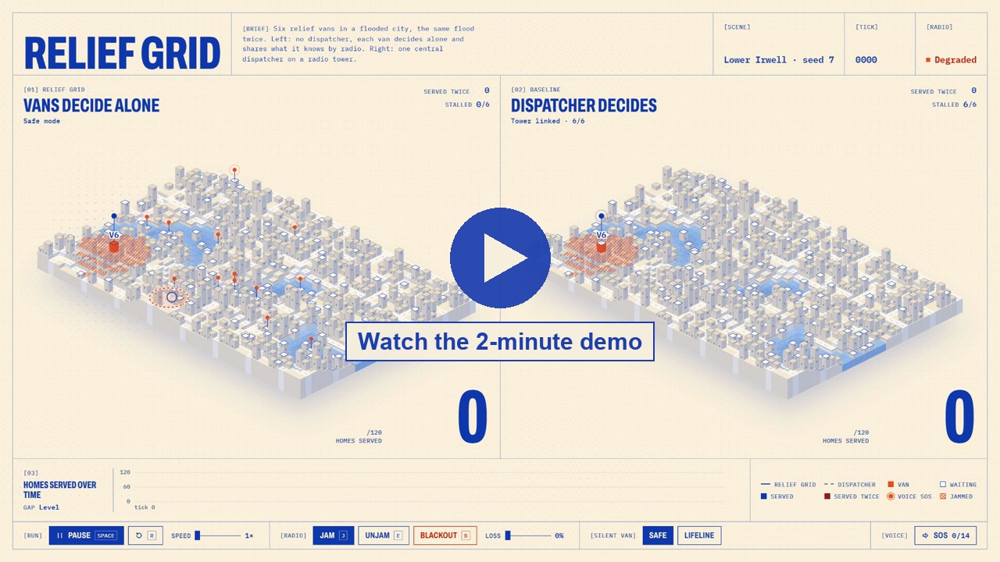

# Relief Grid

Aid vans that keep delivering after a disaster takes the radios down, with no central dispatcher,
and a guarantee that no household is served twice. Built in one day at GreatUniHack 2026 (Manchester) for the
Neptune North challenge, with ElevenLabs and n8n powering HQ.

[](https://youtu.be/gYtxgIP4elE)

**Video (2:07):** https://youtu.be/gYtxgIP4elE · **Devpost text:** [`pitch/devpost.md`](pitch/devpost.md)

## The problem

After Hurricane Maria, about 96% of Puerto Rico's cell sites went down. Most relief logistics assume a dispatcher can
reach every driver. When that link breaks, deliveries stop, or two crews end up at the same door while the next street
waits.

## What you see

One flooded city, simulated twice side by side, with the same six vans and the same 120 homes:

- **Left: Relief Grid.** No dispatcher. Each van decides for itself and shares what it knows with any van in radio range.
- **Right: the baseline.** The same vans run by one central dispatcher on a radio tower.

Break the radio yourself with the jam brush, packet loss or a full blackout. The dispatcher's vans stop and wait for
orders; ours keep serving, and the "served twice" counter stays at zero.

## Results (seed 7, after 300 ticks, measured from the real sim)

| Scenario | Relief Grid | Dispatcher | Served twice (ours) |
|---|---|---|---|
| Base tower jammed, Safe mode | **117** / 120 | 0 | 0 |
| Full blackout, Safe mode | **118** / 120 | 0 | 0 |
| Base tower jammed, Lifeline mode | **120** / 120 | 0 | 3 (counted, shown on screen) |
| 30% packet loss, Safe mode | 120 / 120 | 120 | 0 |
| Radio clear, Safe mode | 102 (120 by tick 500) | **120** | 0 |

With a working radio the dispatcher is faster, and we say so. Relief Grid is for when the radio isn't working.

## How it works

- **Every van is its own Web Worker** running the same pure function, `stepVan(state, percept)` in
  [`sim/van_logic.js`](sim/van_logic.js). A van only learns things from its percept and from radio messages. Nothing
  reads global state, so the sim can't cheat.
- **Ownership without messages (rendezvous hashing).** For each home, every van computes
  `owner(home) = argmax over alive vans of hash(home, van)`. All vans reach the same answer independently, and a van
  only serves homes it owns, so two vans never serve the same home.
- **Gossip that only grows (a CRDT).** When two vans are in range they merge their sets of served homes (union) and
  their lists of alive vans, and hand a home to a nearby van that is closer and still has stock.
- **Safe or Lifeline.** If a van goes silent, is it dead or just out of range? *Safe* keeps its homes reserved for it,
  so nothing is ever served twice. *Lifeline* hands them to other vans for faster coverage and counts every double
  serve. The person running the operation picks the trade-off.
- **A modelled radio** ([`sim/radio.js`](sim/radio.js)) with range, packet loss, delay and jamming. The dispatcher uses
  the same radio, with a longer tower range, so the comparison is fair.

## Voice SOS and HQ (ElevenLabs + n8n + Claude)

Households leave a voice SOS in their own language (English, Arabic, Urdu or Polish). A van carries it, van to van,
until one reaches base. There it is handed to HQ, an **n8n workflow** ([`hq/`](hq/README.md)):

```
webhook → reply cache (never process the same SOS twice)
        → ElevenLabs Scribe: transcribe, any language
        → Claude: translate, triage (needs, urgency 1–3, people), write a reply in the household's language
        → ElevenLabs text-to-speech: spoken reply
        → respond to the van; the reply rides back out on the next van
```

- Every node fails soft: no audio → use the text; Claude down → fixed reply in the right language; text-to-speech down →
  text-only reply; transcription down → HQ asks the van to resend later.
- **HQ can die mid-demo.** The vans never wait for it: [`sim/hq_link.js`](sim/hq_link.js) queues batches and retries
  with backoff, and the backlog flushes in order when HQ is back.
- Tested with the real APIs: a 4-language batch comes back in about 10 seconds, each with correct triage
  (insulin = urgency 3) and a spoken reply.
- The workflow is in [`hq/workflow.json`](hq/workflow.json), built from readable scripts in [`hq/code/`](hq/code/).
  Request and reply format: [`contracts/sos_batch.example.json`](contracts/sos_batch.example.json).

## Run it

```bash
cd sim && python3 -m http.server 8000
```

Open http://localhost:8000. Controls: **Space** run or pause, **R** reset, **J** jam brush, **E** unjam,
**B** blackout, the loss slider, **Safe** or **Lifeline**, and **SOS** to play the voice notes.

Without HQ the page uses a mock HQ (text replies, no API calls). To use a real n8n HQ, open
`http://localhost:8000/?hq=<n8n base URL>`. Setting one up takes about 5 minutes: see [`hq/README.md`](hq/README.md).

## Built with

Plain JavaScript ES modules, HTML Canvas and Web Workers (no framework, no build step, no npm packages), n8n,
ElevenLabs (Scribe and multilingual text-to-speech), Anthropic Claude, Docker and Tailscale.

## Team

| Who | Built |
|---|---|
| Darryll Fonseca | Van logic, gossip and handover, Web Worker tick loop, dispatcher baseline, SOS voice clips |
| Kanishk Sachan | Flood world, radio model, the console UI, pitch and video |
| Akshita Srivastava | HQ n8n workflow (ElevenLabs + Claude), the sim-to-HQ link, the API contract |

How we split the work: [`TASKS.md`](TASKS.md) · plan and interfaces: [`PLAN.md`](PLAN.md) ·
decisions: [`DISCUSSION.md`](DISCUSSION.md) · rules for our AI agents: [`AGENTS.md`](AGENTS.md).

## AI use

All code was written during the hackathon. We used AI coding assistants throughout: Claude Code (Kanishk, Akshita)
and Google Antigravity (Darryll), to plan, write, review and debug code and to help design the interface.
Every change was reviewed by the teammate who owns that file (see [`TASKS.md`](TASKS.md)).
At runtime the HQ workflow uses Claude to translate and triage SOS notes, and ElevenLabs to transcribe them and speak
the replies. Sample SOS voices and the video narration are generated with ElevenLabs text-to-speech, not recorded from
real people.

## Pitch

Demo script, measured numbers and judge Q&A: [`pitch/script.md`](pitch/script.md). The video is made from the real
sim by [`pitch/video/make_video.py`](pitch/video/make_video.py) (also on
[Google Drive](https://drive.google.com/file/d/15dHji0a7RJZlSkJChcY4BRaMA3YlqenP/view?usp=sharing)).
